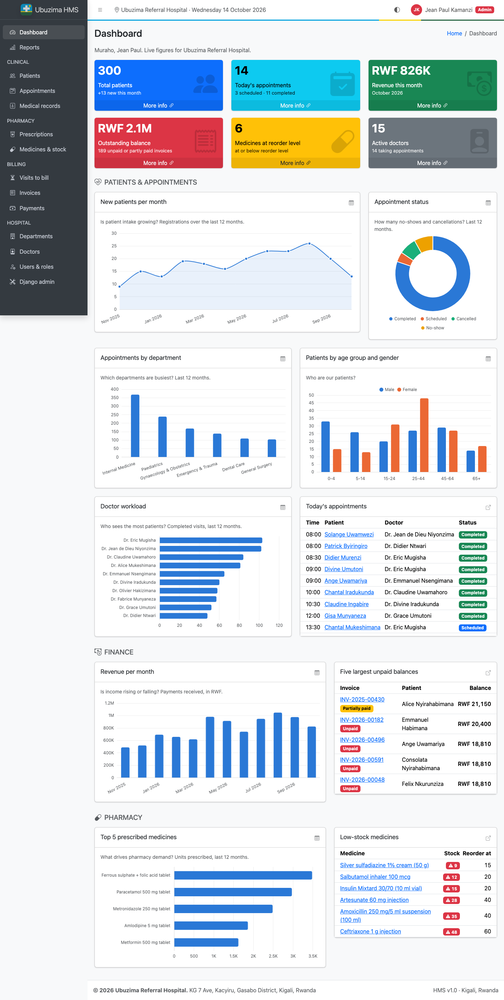

# Hospital Management System & Data Analytics

A Django 5.2 + MySQL hospital system for the fictional **Ubuzima Referral
Hospital** (Kacyiru, Kigali). It digitises the patient journey — registration,
appointments, consultations, prescriptions, pharmacy stock, invoices and
payments — and turns the data into a live analytics dashboard styled with
AdminLTE 4.



## Features

- **Staff login with 5 roles** (Admin, Receptionist, Doctor, Pharmacist, Accountant) and
  role-based access enforced in every view (`RoleRequiredMixin`, `@role_required`).
- **Departments and doctors** (RMDC licence, consultation fee, availability).
- **Patients**: Rwandan national ID (16 digits), +250 phone numbers, all 30 districts,
  Mutuelle de Santé / RSSB / MMI insurance, readable codes `PAT-00001`.
- **Appointments** in 30-minute slots, with double booking blocked by a database
  `UniqueConstraint` plus a friendly form error; past dates and unavailable doctors refused.
- **Consultations**: completing a visit writes the medical record and closes the
  appointment in one transaction.
- **Prescriptions** with an item formset (many-to-many through `PrescriptionItem`);
  **dispensing** locks rows and deducts stock atomically, never below zero.
- **Invoices** generated from the visit (consultation fee + dispensed medicines),
  payments by cash, MTN MoMo / Airtel Money, card or insurance, automatic
  *Unpaid → Partially paid → Paid* status, printable AdminLTE invoice.
- **Analytics dashboard**: 6 KPI cards, 7 Chart.js charts, 3 alert tables, role-aware
  (doctors see their own numbers, accountants see finance first, pharmacists stock first),
  light and dark mode, and a table view behind every chart.
- **Reports** filtered by date range, department, doctor and status, with **CSV export**.
- `seed_data` command that fills 12 months of realistic Rwandan demo data.

## Tech stack

| Layer | Choice |
|---|---|
| Language | Python 3.12 or 3.13 (same minor version on every laptop) |
| Framework | Django 5.2 LTS |
| Database | MySQL 8.4 LTS (`mysqlclient`) |
| UI | AdminLTE 4.0 + Bootstrap 5.3 + Bootstrap Icons, served locally from `static/vendor/` |
| Charts | Chart.js 4.5 |
| Config | `python-decouple` (`.env`) |
| Demo data | `Faker` + curated Rwandan names, places, medicines |

## Setup (about 1 hour per laptop)

1. Install Python 3.12/3.13, MySQL 8.4 and Git, then clone the repository.
   Check the server version with `SELECT VERSION();`; Django 5.2 needs MySQL 8.0.11+
   (XAMPP's bundled MariaDB is often too old).
2. Create the database and a user (run in the MySQL shell as root):

   ```sql
   CREATE DATABASE hospital_db CHARACTER SET utf8mb4 COLLATE utf8mb4_unicode_ci;
   CREATE USER 'hms_user'@'localhost' IDENTIFIED BY 'choose-a-password';
   GRANT ALL PRIVILEGES ON hospital_db.* TO 'hms_user'@'localhost';
   GRANT ALL PRIVILEGES ON test_hospital_db.* TO 'hms_user'@'localhost';  -- for `manage.py test`
   ```

3. Create and activate a virtual environment:

   ```bash
   python3 -m venv venv
   source venv/bin/activate          # Windows: venv\Scripts\activate
   pip install -r requirements.txt
   ```

4. Copy `.env.example` to `.env` and fill in `DB_PASSWORD` and a long random `SECRET_KEY`
   (`python -c "import secrets; print(secrets.token_urlsafe(50))"`).
5. Build the tables, load the demo data and start the server:

   ```bash
   python manage.py migrate
   python manage.py seed_data            # add --reset to wipe and reseed
   python manage.py runserver
   ```

6. Open <http://127.0.0.1:3000> and sign in.

### Demo logins

`seed_data` creates one login per role. **Password for every account: `Ubuzima@2026`.**

| Username | Name | Role |
|---|---|---|
| `admin` | Jean Paul Kamanzi | Admin (also Django admin superuser) |
| `receptionist` | Aline Uwase | Receptionist |
| `doctor` | Dr. Eric Mugisha | Doctor, Internal Medicine |
| `pharmacist` | Josiane Ingabire | Pharmacist |
| `accountant` | Patrick Habimana | Accountant |

The other 14 doctors sign in as `dr.<lastname>` (e.g. `dr.mukeshimana`) with the same password.
Run `seed_data` on the demo morning: today's clinic list is built around the time you seed.

### What the seed creates

6 departments, 15 doctors, 40 essential medicines priced in RWF, 300 patients
(a quarter registered 1–3 years ago) and about 1,200 appointments over the last
13 months with a growing trend, then consultations, prescriptions, invoices and
payments. Insured patients pay their co-pay at the cashier (10% for Mutuelle,
15% for RSSB/MMI) and the insurer settles weeks later, so recent invoices are
often *Partially paid*. All people are fictional; no real patient data is used.

## Project structure

```
config/          settings.py, root urls.py (include() per app)
accounts/        User (5 roles), login/logout, users CRUD, RoleRequiredMixin, template filters
staff/           Department, Doctor
patients/        Patient
appointments/    Appointment, MedicalRecord, complete/cancel/no-show workflows
pharmacy/        Medicine, Prescription, PrescriptionItem, services.dispense_prescription
billing/         Invoice, InvoiceItem, Payment, services.generate_invoice, print view
analytics/       dashboard, reports, CSV export, queries.py, management/commands/seed_data.py
templates/       base.html, partials/ (navbar, sidebar, footer, messages, pagination,
                 form fields, formset), registration/login.html, 403/404/500
static/          vendor/ (AdminLTE, Bootstrap, icons, Chart.js), css/custom.css, js/
docs/            ERD.md + erd.dbml, USER_GUIDE.md, screenshots/
```

Foreign keys only point "downstream" (accounts → staff/patients → appointments →
pharmacy → billing → analytics), so apps never import each other in a circle.

## Where each assessed skill lives

| Requirement | Where to look |
|---|---|
| URL configuration | `config/urls.py` (`include()` for 7 apps), each app's `urls.py` with `app_name`, `<int:pk>` converters, `` / `reverse_lazy` everywhere |
| Views | Generic CBVs for CRUD (e.g. `patients/views.py`); FBVs for workflows: `appointment_complete`, `prescription_dispense`, `invoice_generate`, `dashboard`, `export_csv` |
| Templates | `templates/base.html` + `partials/`, `form_base.html` / `confirm_delete_base.html`, per-app template folders, `json_script`, `date`, custom `rwf` filter |
| Multiple apps | 7 apps, one responsibility each |
| Relational design | 12 tables, 1:1 / 1:N / M:N-through, `UniqueConstraint`, `CheckConstraint`, `PROTECT` / `CASCADE` / `SET_NULL` — see [docs/ERD.md](docs/ERD.md) |
| CRUD | Full CRUD for 10 entities in AdminLTE pages; deletes go through a confirmation page and POST |
| AdminLTE | Hand-split layout (navbar, sidebar, footer), small boxes, cards, info boxes, login, invoice and error pages |
| Data analytics | `analytics/queries.py` (`TruncMonth`, `Case/When`, `Count`/`Sum` with filters, subqueries), `static/js/dashboard.js` |

## Notes and troubleshooting

- **Monthly charts and MySQL time zones.** `DATABASES["default"]["TIME_ZONE"]` is set to
  `Africa/Kigali`, the same as `TIME_ZONE`, so Django never wraps columns in `CONVERT_TZ()`.
  `TruncMonth` and `__date` lookups therefore work even when MySQL's time-zone tables are
  not loaded.
- **`mysqlclient` will not install** (often on Windows): use a Python version with a prebuilt
  wheel, or `pip install PyMySQL` and add this to `config/__init__.py`:

  ```python
  import pymysql
  pymysql.install_as_MySQLdb()
  ```

- **Logout returns 405**: Django 5 logs out with POST only; use the *Sign out* button.
- **AdminLTE looks unstyled**: check the browser console for 404s on `/static/...`;
  all assets are local under `static/vendor/`, so the demo works offline.
- **Empty dashboard**: run `python manage.py seed_data` right after `migrate`.
- **Hospital name**: set `HOSPITAL_NAME`, `HOSPITAL_ADDRESS`, `HOSPITAL_TIN`… in `.env`.
- **Backup for demo day**: `mysqldump -u hms_user -p hospital_db > hospital_db.sql`.

More: [User guide (one section per role)](docs/USER_GUIDE.md) ·
[ERD](docs/ERD.md) · [Screenshots](docs/screenshots/) ·
[Deploying to PythonAnywhere](docs/DEPLOY_PYTHONANYWHERE.md)
