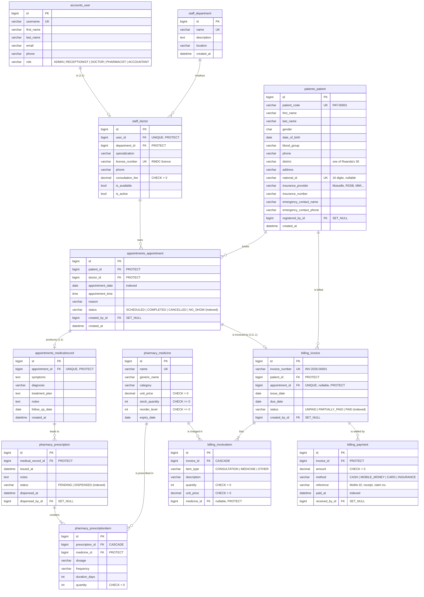

# Entity–relationship diagram

12 tables in 6 apps, using all three Django relationship types. GitHub renders
the diagram below; to export an image for the report, paste
[`erd.dbml`](erd.dbml) into <https://dbdiagram.io> and use **Export → PNG**.

`created_by`, `registered_by`, `dispensed_by` and `received_by` also point to
`accounts_user` (audit fields, `SET_NULL`); they are left off the diagram to
keep it readable.

## Relationship types to point out in the demo

| Type | Example | Django field |
|---|---|---|
| One-to-one | User ↔ Doctor | `OneToOneField` |
| One-to-one | Appointment ↔ MedicalRecord | `OneToOneField` |
| One-to-one (optional) | Appointment ↔ Invoice | `OneToOneField(null=True, blank=True)` |
| One-to-many | Department → Doctors, Patient → Appointments, Invoice → Payments | `ForeignKey` |
| Many-to-many with extra data | Prescription ↔ Medicine via PrescriptionItem (dosage, quantity) | `ManyToManyField(through="PrescriptionItem")` |

## Constraints

- `unique_doctor_slot`: (doctor, appointment_date, appointment_time) blocks double booking.
- `unique_medicine_per_prescription`: a medicine appears once per prescription.
- `CHECK` constraints: payment amount, unit prices, quantities and consultation fee must be > 0.
- `PROTECT` keeps history (a prescribed medicine or a patient with visits cannot be deleted);
  `CASCADE` only for child rows (PrescriptionItem, InvoiceItem); `SET_NULL` for audit fields.
